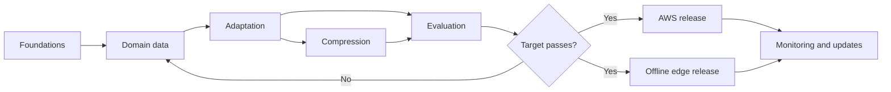

# Bookmap and Learning Routes

Use this page to choose what to read and in what order. The [original project brief](prompt.txt) defines the full scope;
this map turns that large scope into manageable routes.

## Start with your goal

### I want to understand SLMs

Read Parts I–III, then the evaluation chapters:

1. [Language model foundations](02-textbook/part-01-language-model-foundations/README.md)
2. [Training and domain adaptation](02-textbook/part-02-training-and-domain-adaptation/README.md)
3. [Parameter-efficient fine-tuning](02-textbook/part-03-parameter-efficient-fine-tuning/README.md)
4. [Evaluation and experiments](02-textbook/part-08-evaluation-benchmarking-and-research-experiments/README.md)

This route explains what changes during adaptation and how to tell whether the change helped.

### I want to build a specialist model

Read the foundations, then follow the data-to-evaluation route:

1. [Data acquisition and dataset engineering](02-textbook/part-06-data-acquisition-and-dataset-engineering/README.md)
2. [Implementation handbook](03-implementation-handbook/README.md)
3. [Automotive case study](07-automotive-case-study/README.md)
4. [Experiment framework](06-experiment-framework/README.md)

The automotive example is a worked path, not a claim that its experiments have already run. Replace its domain
configuration and data only after you understand the safety, rights, and evaluation differences in your own domain.

### I want a smaller or faster model

Read [compression and optimization](02-textbook/part-04-model-compression-and-optimization/README.md), then
[edge benchmarking](02-textbook/part-08-evaluation-benchmarking-and-research-experiments/README.md). A smaller file is
not necessarily a faster model: the runtime needs kernels that can use the chosen format, and peak memory includes more
than weights.

### I want to deploy

- For cloud training and serving, use the [AWS guide](08-aws-guide/README.md).
- For offline phones and edge computers, use the [edge guide](09-edge-guide/README.md).
- For secure delivery from cloud to device, read
  [AWS training and deployment](02-textbook/part-09-aws-training-optimization-and-deployment/README.md).

Deployment chapters teach the procedure and validation checks. They do not imply that this repository has provisioned
an AWS endpoint or passed a build on a physical phone.

### I want to support several domains

Read [multi-domain SLM engineering](02-textbook/part-07-multi-domain-slm-engineering/README.md), then use the
[reusable architecture](10-multi-domain-architecture/README.md). The central choice is whether to maintain independent
models, one shared model with adapters, or a multi-domain model. Make that choice from measured interference, storage,
latency, safety, and maintenance results—not from convenience alone.

## How the material fits together

This is a learning and engineering loop. Evaluation can send you back to the dataset, training method, or compression
choice. A release is not the end: model behavior, dependencies, costs, and safety guidance change.

## Complete textbook sequence

The [textbook index](02-textbook/README.md) is the chapter-level table of contents.

1. [Part I — Language Model Foundations, Chapters 1–3](02-textbook/part-01-language-model-foundations/README.md)
2. [Part II — Training and Domain Adaptation, Chapters 4–7](02-textbook/part-02-training-and-domain-adaptation/README.md)
3. [Part III — Parameter-Efficient Fine-Tuning, Chapters 8–9](02-textbook/part-03-parameter-efficient-fine-tuning/README.md)
4. [Part IV — Model Compression and Optimization, Chapters 10–15](02-textbook/part-04-model-compression-and-optimization/README.md)
5. [Part V — Edge AI and Mobile Inference, Chapters 16–22](02-textbook/part-05-edge-ai-and-mobile-inference/README.md)
6. [Part VI — Data Acquisition and Dataset Engineering, Chapters 23–26](02-textbook/part-06-data-acquisition-and-dataset-engineering/README.md)
7. [Part VII — Multi-Domain SLM Engineering, Chapters 27–28](02-textbook/part-07-multi-domain-slm-engineering/README.md)
8. [Part VIII — Evaluation and Experiments, Chapters 29–32](02-textbook/part-08-evaluation-benchmarking-and-research-experiments/README.md)
9. [Part IX — AWS Training and Deployment, Chapters 33–36](02-textbook/part-09-aws-training-optimization-and-deployment/README.md)
10. [Part X — Automotive Hands-On Project, Chapter 37](02-textbook/part-10-complete-hands-on-project/README.md)
11. [Part XI — Extending to Other Domains, Chapters 38–41](02-textbook/part-11-extending-the-platform-to-other-domains/README.md)
12. [Part XII — Production, Safety, and Maintenance, Chapters 42–44](02-textbook/part-12-production-engineering-safety-and-maintenance/README.md)
13. [Part XIII — Experimental Roadmap, Chapters 45–46](02-textbook/part-13-experimental-research-roadmap/README.md)
14. [Part XIV — Final Engineering Architecture, Chapter 47](02-textbook/part-14-final-engineering-architecture/README.md)

Use the [detailed contents](01-planning/detailed-table-of-contents.md) for section-level navigation. Keep the
[glossary](12-reference-library/glossary.md) open when a term is unfamiliar, and use the
[assessments](13-assessments/README.md) to check understanding.

## Companion resources

- [Research comparisons](04-research-comparison-report/README.md) compare methods without treating newer as better.
- [Dataset guide](05-dataset-guide/README.md) covers source rights, lineage, cleaning, and domain examples.
- [Research roadmap](11-research-roadmap/README.md) orders future experiments by learning value and cost.
- [Reference library](12-reference-library/README.md) contains definitions, sources, and abbreviations.
- [Decision framework](14-decision-framework/README.md) turns measurements into target-specific choices.
- [Governance guide](00-governance/README.md) explains evidence, reproducibility, safety, and release rules.
- [Audit ledgers](15-audit-ledgers/README.md) record what evidence exists and what still needs validation.

## How to interpret unexecuted work

The repository contains complete explanatory procedures for experiments, cloud deployment, and device testing, but it
does not yet contain the resulting project measurements. When you see `PLANNED EXPERIMENT`, read it as “follow these
steps to answer this question.” When you see `UNVERIFIED IMPLEMENTATION`, read it as “the code is supplied, but you must
perform the listed checks on the stated target before relying on it.”

For example, a quantization comparison can be fully teachable before it runs: the hypothesis, fixed baseline, metrics,
device controls, commands, and acceptance rule can all be explained. The honest conclusion remains “run this protocol
to determine the winner,” not “the chapter is incomplete” and not “4-bit is best.”

At present, the repository does not claim an approved production dataset, a trained release model, a benchmark winner,
a deployed AWS service, a qualified mobile build, or completed expert and legal approval.

## Architectural and safety boundary

The primary model must learn domain capability during training and run without retrieving documents at answer time.
External sources are allowed for data preparation and evaluation; vector search, dynamic passage injection, and remote
teacher answers are not allowed in the primary inference path. See the
[no-runtime-RAG standard](00-governance/no-runtime-rag-standard.md).

This constraint does not make the model factual or safe. Pharmacy, repair, and animal-care outputs can cause harm when
they are stale, incomplete, or misapplied. Follow the
[safety and risk standard](00-governance/safety-and-risk-standard.md) and require qualified human review for
high-consequence material.

## Validation state

The documentation set is navigable and substantive. Training and optimization experiments, AWS deployment, physical
device qualification, current cost measurement, and safety-critical domain approval still need to be carried out and
recorded. Before making a release claim, use the [definition of done](00-governance/definition-of-done.md) and confirm
the supporting records in the [audit ledgers](15-audit-ledgers/README.md).
